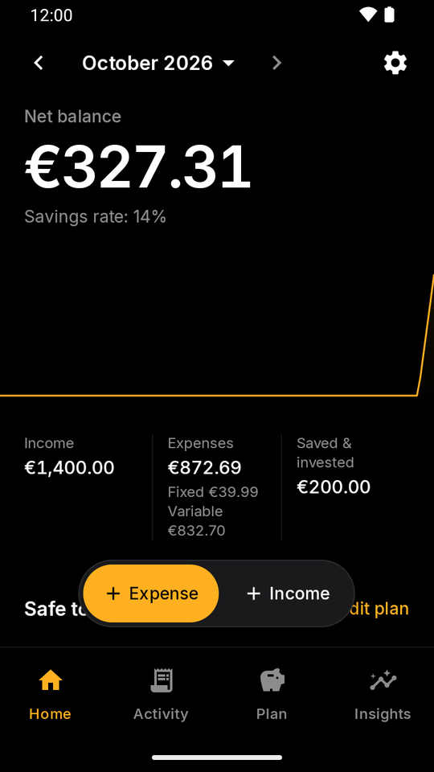
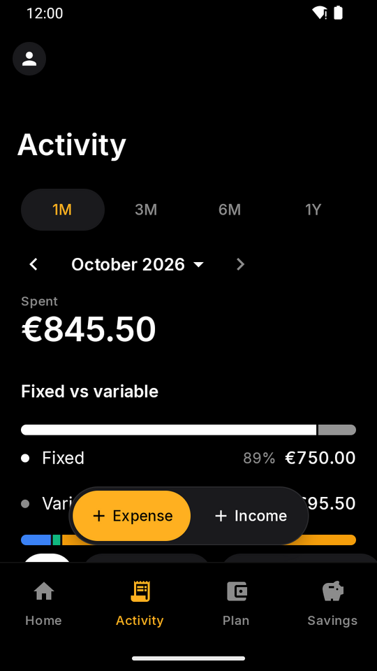
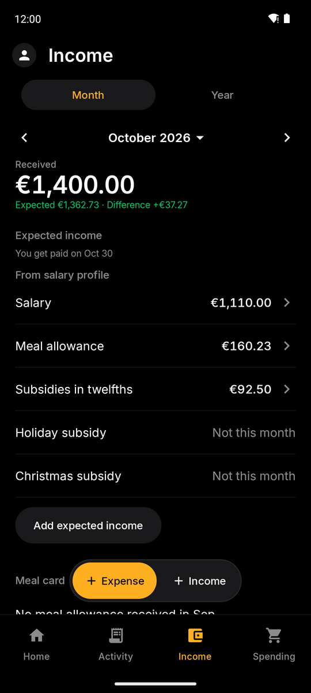
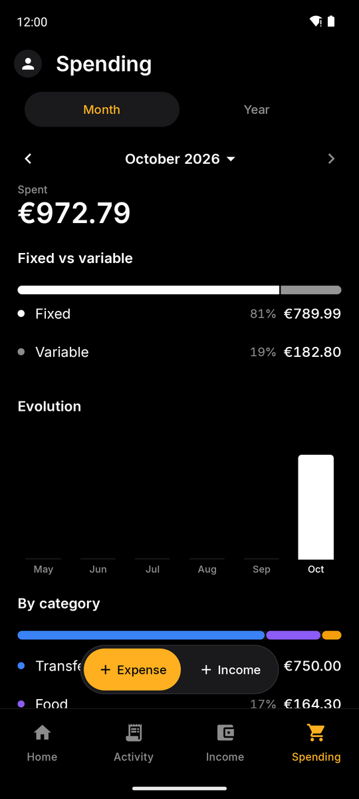
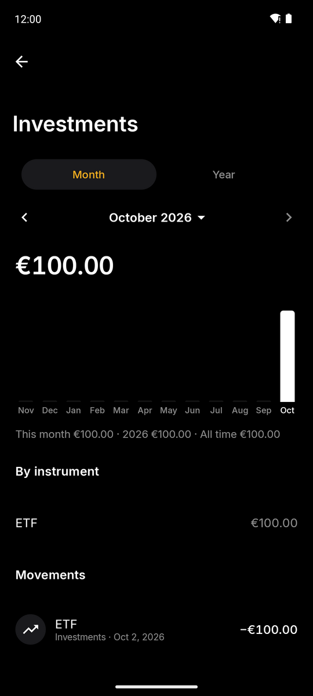
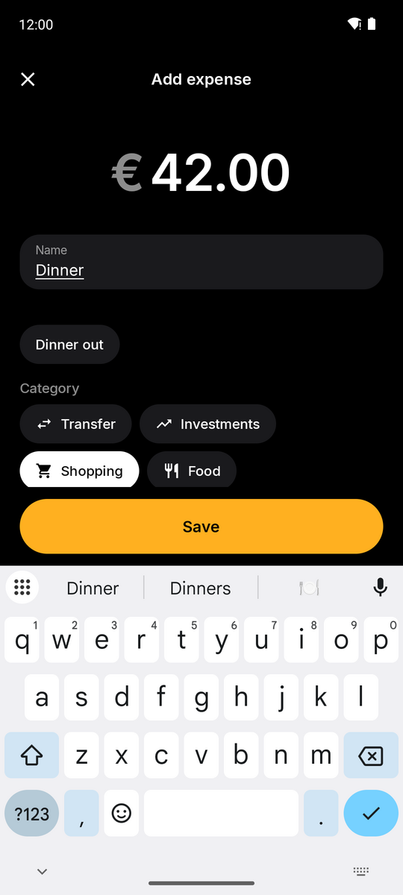
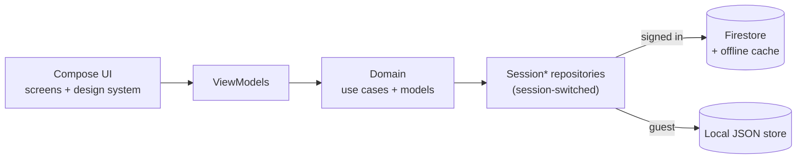

<p align="center">
  
</p>

<h1 align="center">FinTrack</h1>

<p align="center">
  A monthly money-tracking app for Android: track what you earn and spend, month by month, and keep
  recurring bills and investments under control.
</p>

<p align="center">
  <a href="https://github.com/joaoeoneves/fintrack/actions/workflows/ci.yml"></a>
  <a href="https://github.com/joaoeoneves/fintrack/releases/latest"></a>
  <a href="LICENSE"></a>
  
  
</p>

<p align="center">
  
  
  
  
  
  
</p>

## Why

FinTrack started as a personal replacement for a monthly budgeting spreadsheet. The app keeps its
focus on real numbers: what came in, what went out, what was invested, and how each month compares.
Income and spending are tracked separately and each month stands on its own: there is no rollover and
no "available to spend". It works offline-first, and it can be used without an account at all (guest
mode).

## Features

**Tabs**
- Home, Activity, Income and Spending, plus an avatar with your initial that opens Account & settings.
  Every tab has the same Month | Year switch (calendar year).
- **Home**: a **Get started** checklist (hidden when done), a **To review** card (records posted
  automatically and "Make it recurring?" suggestions), an income card (received of expected), a spending
  card, an *Invested* row with the share of what you received ("you invested 12% of what you received")
  that opens the investments page, quick add and an informative list of what is coming up.
- **Activity**: the list of expenses and income, with search, type, category, group and income source
  filters, sorting, and delete by swiping or from the edit screen (with undo). Totals and breakdowns live
  in Spending and Income.
- **Income**: received versus expected with the difference, income lines, days off by type
  (vacation, sick leave, other; one month or several at once; the working-day count follows from the
  calendar, holidays and days off), and history. Income counts by the date it was
  received.
- **Spending**: spent, fixed versus variable, evolution, and spending by category or by group (a name
  plus its categories) with a Category | Group switch. Recurring bills and investments are managed here,
  with their yearly cost (monthly and yearly items apart) and the month each one ends.
- Tapping a bar in a year chart shows that month's figures and opens the month.
- Detail pages per category and per income source. For the net salary source it shows what was received
  at the end of a month against what was spent in the next one.

**Tracking**
- Expenses (name, amount, category, date, note) and income (source, amount, date, note). Refunds
  subtract from their category. When you add an expense, the category you used last time for that name
  is suggested.
- Categories: built-ins plus your own (new users also start with Home, Transport, Health and Leisure) (name, icon, colour, spending or saving), with rename, reorder,
  archive and delete.
- Income lines that change over time keep their history: a new amount applies
  from the month you choose (*Valid from*) and earlier months keep the old one.
- CSV export for expenses.

**Income lines**
- The salary profile (optional) and your own lines, one row per component. Salary set-up is three steps
  (gross or net, subsidies, meal allowance); the full form under Advanced covers youth IRS, deductions
  and extras (a fixed amount, a multiple of the base or a share of the annual gross, paid in the months
  you choose).
- Any line can be recorded automatically on its pay day (last working day, with Portuguese holidays, or
  a fixed day). Income can be per working day, with days off and a Carnival shortcut.
- The salary profile shows the vacation days left this year, and an optional annual raise in February
  makes a new salary apply from February (January keeps the previous one).

**Bills and investments**
- Monthly or yearly recurring expenses (rent, subscriptions) and recurring investments, with start and
  end dates and pause/resume.
- Every recurring item is recorded automatically on its due date and shows up in *To review*, where you
  can check or change it. Recording twice (for example from a second device) never creates a duplicate.
  The upcoming list on Home is informative.

**Guest mode and backup**
- "Continue as guest" uses the whole app with data kept in a single JSON file on the device; no Firebase
  is involved.
- Signing in later offers to copy guest data into the account, then to remove it from the device.
- Versioned JSON backup and restore (for example to move to another phone), for guests and signed-in
  accounts. Restoring into an account offers to export a backup first. A "delete all data" action is
  also available.

**Localization and appearance**
- English and Portuguese (pt-PT), switchable in-app; follows the system language by default.
- System, light or dark theme. Motion (smooth transitions, predictive back, counting amounts, skeleton
  loading and haptics) follows the system's animation setting.
- Amounts are in euros.

**Privacy-relevant bits**
- Sign-in is Google via Credential Manager; data is stored under your own user id and Firestore security
  rules restrict every document to its owner (see [SECURITY.md](SECURITY.md)).
- Guest data never leaves the device unless you export a backup.

## Download and install

Signed APKs are attached to each [GitHub release](https://github.com/joaoeoneves/fintrack/releases/latest)
(Android 8.0+). To get updates automatically, add `https://github.com/joaoeoneves/fintrack` as a source in
[Obtainium](https://obtainium.imranr.dev/).

v1.0 was signed with a debug key, so moving to the signed builds requires uninstalling the app once. This
clears local (guest) data; Firestore data is unaffected.

## Tech stack

| Area | Choice |
|---|---|
| Language | Kotlin 2.4.10 |
| UI | Jetpack Compose (BOM 2026.06.01) with Material 3 and a small in-house design system (`ui/designsystem`), Inter typeface |
| Architecture | MVVM, `StateFlow` UI state, type-safe Compose Navigation 2.9 |
| Async | Coroutines 1.11 and `Flow` |
| DI | Hilt 2.60 with KSP |
| Backend | Firebase Auth (Google Sign-In through `androidx.credentials`) and Firestore (BoM 34.16) with its offline cache |
| Local storage | JSON file via kotlinx.serialization 1.11 (guest mode), Preferences DataStore 1.3 (settings, session) |
| Performance | R8 minification, Baseline Profiles (`:baselineprofile` module), splash screen API |
| Quality | ktlint, detekt, Android lint, JUnit 4, Robolectric, Maestro |
| Build | AGP 9.3, Gradle version catalog, GitHub Actions, Dependabot |

## Architecture



ViewModels depend only on repository interfaces from `domain/`. Hilt binds each interface to a
`Session*Repository` that routes every call to the Firestore or the local JSON implementation for the
current session, so UI code does not know which one is in use and a guest never creates Firestore.
Details, the data model and the rules approach are in [docs/ARCHITECTURE.md](docs/ARCHITECTURE.md);
the reasoning behind the main choices is in [docs/DECISIONS.md](docs/DECISIONS.md).

## Quality

- **2,700+ unit tests** (JVM, run against in-memory fake repositories; Robolectric where an Android
  class is unavoidable).
- **JVM screen tests** (Robolectric + Compose) drive the main flows on every PR, with no emulator.
- **Maestro E2E flows** (`.maestro/`, guest mode) can be run on demand from the E2E workflow or by hand.
- **CI** once per pull request, as two parallel jobs: ktlint, detekt and Android lint; unit tests, the debug
  build and compilation of the baseline-profile generator. Nothing runs twice: main doesn't re-run CI.
- **Baseline profile** generated on a CI emulator and committed.
- **Signed releases**: the Release workflow (run it with a version, or push a tag `vX.Y`) checks that
  CI passed on the merged pull request, builds (R8) and signs the APK, verifies the signature, and
  publishes a GitHub release with the APK and the R8 mapping file.

Run the same checks locally with the shared gate script:

```bash
scripts/gate.sh fast                 # ktlint + detekt + unit tests
scripts/gate.sh fast 'com.joaoeoneves.fintrack.ui.recurring.*'   # filtered unit tests
scripts/gate.sh full                 # everything CI checks, plus androidTest compilation
```

## Getting started

Requires JDK 21 and an Android SDK (`ANDROID_HOME`).

1. Clone the repository.
2. Create a Firebase project, register an Android app with package `com.joaoeoneves.fintrack`, enable
   Google Sign-In, create a Firestore database and deploy [`firestore.rules`](firestore.rules).
3. Put your own `google-services.json` in `app/` (it is gitignored) and add your debug certificate's
   SHA-1 to the Firebase app (`./gradlew signingReport` prints it).
4. Build and run:

   ```bash
   ./gradlew installDebug
   ```

Guest mode works without any Firebase sign-in, but the build still needs a `google-services.json`
(CI uses a placeholder one).

## Project structure

```
app/src/main/java/com/joaoeoneves/fintrack/
├── ui/        Compose screens by feature (dashboard, activity, income, spending, detail, expense,
│              recurring, settings, ...), designsystem/, theme/, navigation/
├── data/      Firestore repositories, local/ (guest JSON store), session/ (switching), backup/,
│              migration/, preferences/, csv/, automation/ and salary/ (app-start syncs)
└── di/        Hilt modules
core/model/            pure-Kotlin module: domain models, repository interfaces, use cases
app/src/test/          JVM unit tests and shared fakes
app/src/androidTest/   instrumented tests
baselineprofile/       baseline profile generator module
.maestro/              Maestro E2E flows
firestore.rules        Firestore security rules
scripts/gate.sh        shared quality gate
```

## Roadmap

- Further polish of the income and spending screens based on day-to-day use.
- Broader instrumented-test coverage.

## Contributing

See [CONTRIBUTING.md](CONTRIBUTING.md). Changes are listed in [CHANGELOG.md](CHANGELOG.md).

## License

[MIT](LICENSE) © 2026 João Neves.

The bundled typeface is [Inter](https://github.com/rsms/inter) by Rasmus Andersson, licensed under the
SIL Open Font License 1.1 (see [`third_party/inter/OFL.txt`](third_party/inter/OFL.txt)).
