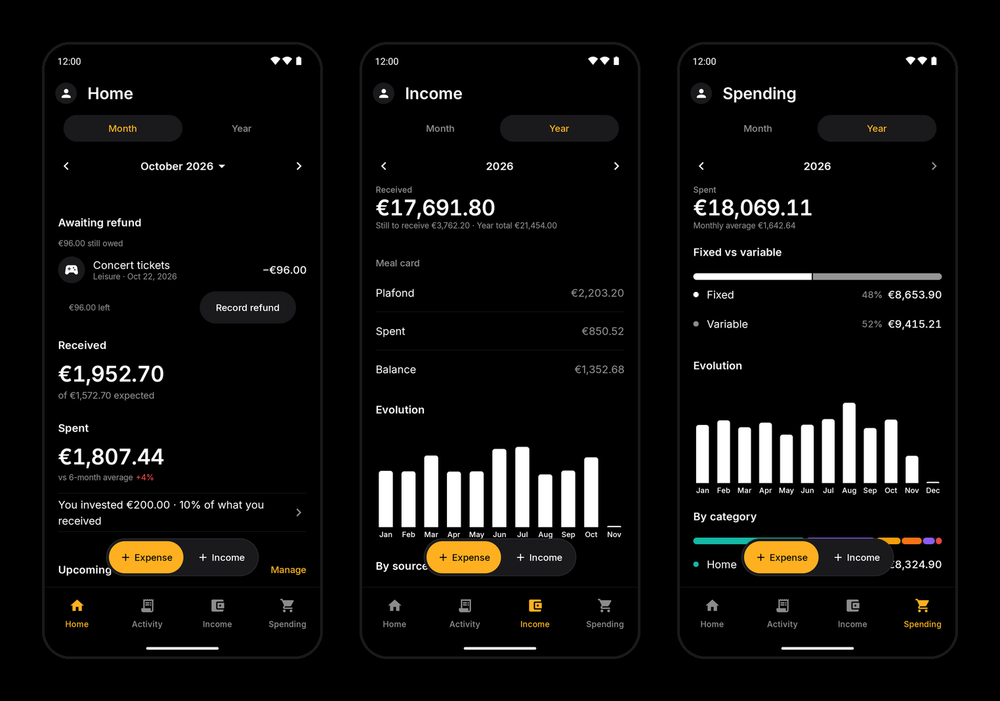
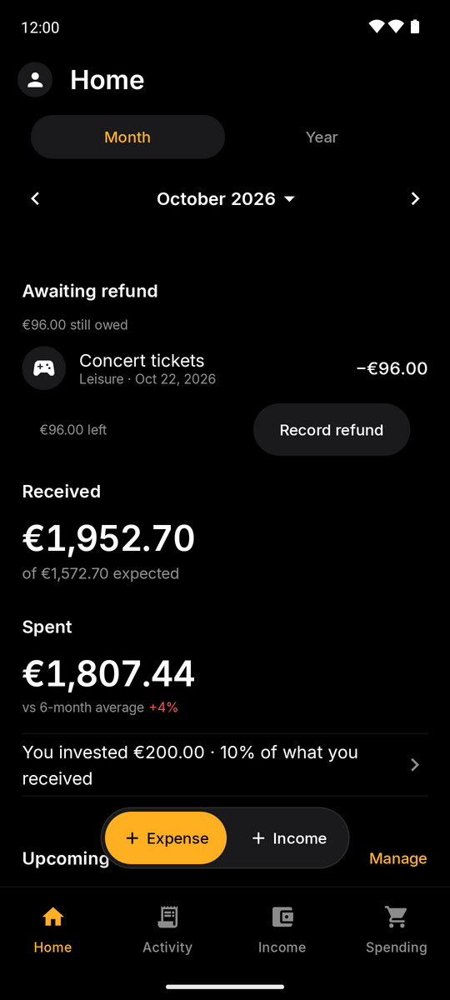
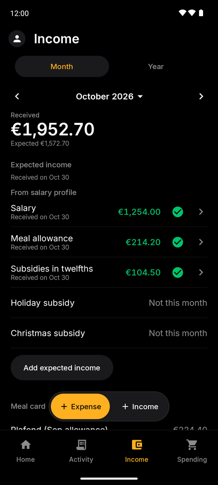
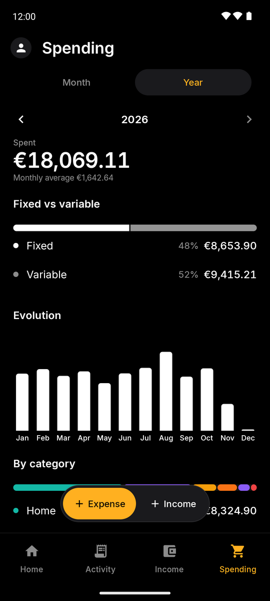
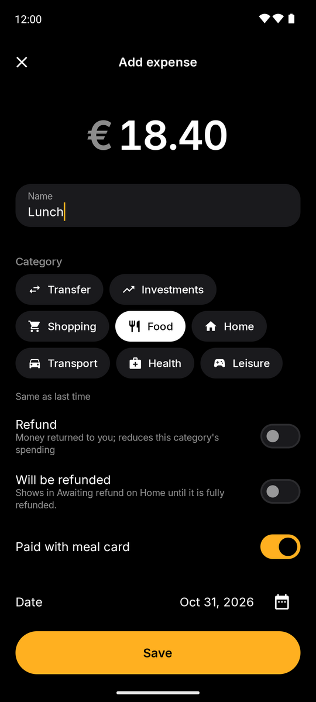
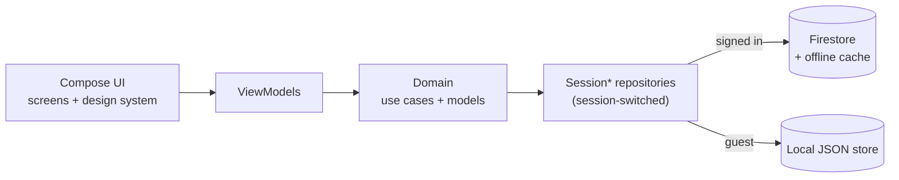

<p align="center">
  
</p>

<h1 align="center">FinTrack</h1>

<p align="center">
  <b>A monthly money tracker for people paid in euros.</b><br>
  What came in against what was expected, what went out, what was invested: month by month,<br>
  with no envelopes, no bank login and no account needed.
</p>

<p align="center">
  <a href="https://github.com/joaoeoneves/fintrack/releases/latest"></a>
  <a href="https://github.com/joaoeoneves/fintrack/actions/workflows/release.yml"></a>
  <a href="LICENSE"></a>
  
  
</p>

<p align="center">
  <a href="https://github.com/joaoeoneves/fintrack/releases/latest"><b>Download the APK</b></a> ·
  <a href="https://apps.obtainium.imranr.dev/redirect?r=obtainium://add/https://github.com/joaoeoneves/fintrack"><b>Add to Obtainium</b></a> ·
  <a href="docs/FEATURES.md">All features</a>
</p>

<p align="center">
  
</p>

## Why another money app?

Most budgeting apps want you to plan every euro in advance, or to hand them your bank login. FinTrack started as
the replacement for a personal monthly spreadsheet and keeps that spreadsheet's honesty: real numbers, each month
on its own.

- **It knows how you're paid.** Set your salary once, gross or net: Social Security and IRS withholding (including
  IRS Jovem), holiday and Christmas subsidies in twelfths or in full, meal allowance on a card, working days with
  Portuguese holidays, vacation days. FinTrack then knows what *should* come in each month, and shows what is
  still to receive.
- **Real numbers, each month on its own.** No envelopes, no rollover, no "safe to spend". What came in, what went
  out, what you invested and how this month compares with the last ones.
- **Recurring things record themselves.** Rent, subscriptions and investments are recorded on their date and
  wait in *To review* until you confirm them. They never duplicate, even from a second phone.
- **Refunds that actually net out.** Shared dinners, insurance, family paying you back: link the refund to the
  expense and the category shows what you really spent. Anything still owed stays on Home until it's paid.
- **Yours, with no strings attached.** Use it without an account (everything in one file on your phone), or sign
  in with Google to sync. No bank access, no ads, no analytics, no crash reporting. JSON backups you can read,
  CSV export, MIT licence.

## How it compares

|                                              | Envelope budgeting apps | Bank-sync aggregators | Simple expense loggers | A spreadsheet    | **FinTrack**       |
|----------------------------------------------|:-----------------------:|:---------------------:|:----------------------:|:----------------:|:------------------:|
| Understands a Portuguese payslip             | —                       | —                     | —                      | if you build it  | **yes**            |
| Expected vs received income, per month       | partly                  | partly                | —                      | if you build it  | **yes**            |
| Recurring bills recorded on their date       | yes                     | from the bank         | sometimes              | by hand          | **yes, reviewed**  |
| Refunds netted against the original expense  | sometimes               | sometimes             | —                      | by hand          | **yes**            |
| Imports transactions from your bank          | some                    | **yes**               | —                      | —                | no, by design      |
| Works without an account                     | rarely                  | —                     | often                  | yes              | **yes**            |
| Needs access to your bank                    | some                    | yes                   | no                     | no               | **no**             |
| Ads or tracking                              | varies                  | varies                | often                  | no               | **none**           |
| Open source                                  | rarely                  | rarely                | sometimes              | —                | **MIT**            |

If you want every transaction imported automatically, or to budget every euro before the month starts, an
aggregator or an envelope app will suit you better. FinTrack is for writing things down yourself, in a few
seconds, and seeing clearly where the month went.

**Is it for you?** Yes if you're paid in euros (best of all in Portugal, where the salary model applies) and
want a clear monthly picture without connecting your bank. Not yet if you need several currencies, iOS, or a
budget shared by a household.

## A look around

<table>
  <tr>
    <td width="50%"></td>
    <td width="50%">
      <h3>Home</h3>
      The month at a glance: what came in against what was expected, what was spent against your recent average,
      the share of your income you invested, what is still owed to you, and what's coming up.
      Automatic records wait in <i>To review</i>.
    </td>
  </tr>
  <tr>
    <td width="50%">
      <h3>Income</h3>
      Every expected line (salary, subsidies, meal allowance, your own lines), ticked as it arrives.
      The Year view adds up what has come in and what is still to receive until December, plus the meal card
      balance.
    </td>
    <td width="50%"></td>
  </tr>
  <tr>
    <td width="50%"></td>
    <td width="50%">
      <h3>Spending</h3>
      Fixed against variable, month-by-month evolution, and spending by category or by group. Categories above
      their recent average are flagged. Recurring bills and investments are managed here, with what each one
      costs per year.
    </td>
  </tr>
  <tr>
    <td width="50%">
      <h3>Adding an expense</h3>
      Amount first, then a name: the category you used last time for that name is picked for you. Split an
      expense across categories, mark it as paid with the meal card, or flag it as <i>Will be refunded</i>.
    </td>
    <td width="50%"></td>
  </tr>
</table>

Activity (search and filters) and the Year views are in [docs/screenshots](docs/screenshots). The full list of
what the app does is in [docs/FEATURES.md](docs/FEATURES.md).

## Privacy

|                     | Guest mode                              | Signed in (Google)                                                       |
|---------------------|-----------------------------------------|--------------------------------------------------------------------------|
| Where your data is  | One JSON file in the app's storage      | Firestore, under your own user id, plus an offline cache on the phone     |
| Who can read it     | Only you, on that phone                 | Only your account: security rules restrict every document to its owner   |
| Leaves the phone    | Only if you export a backup             | Synced to Firestore                                                      |

In both modes: no bank credentials, no ads, no analytics or crash reporting, an optional app lock (fingerprint,
face or screen lock), and backups in a readable JSON format you can take anywhere. Signing in later offers to
move your guest data into the account. See [SECURITY.md](SECURITY.md) for how to report a problem.

## Install

Signed APKs for Android 8.0 and later are attached to every [release](https://github.com/joaoeoneves/fintrack/releases/latest).
To get updates automatically, add `https://github.com/joaoeoneves/fintrack` as an app in
[Obtainium](https://obtainium.imranr.dev/). The app is in English and Portuguese (pt-PT), with dark, light and
system themes.

## Built with

Kotlin 2.4 and Jetpack Compose (Material 3 with a small in-house design system and the Inter typeface), MVVM with
`StateFlow`, type-safe Compose Navigation, coroutines and `Flow`, Hilt, Firebase Auth and Firestore, a
kotlinx.serialization JSON store for guest mode, DataStore, R8 and Baseline Profiles.



ViewModels only see repository interfaces from the pure-Kotlin domain module. Each one is bound to a repository
that routes every call to Firestore or to the local JSON store for the current session, so no screen knows which
one is in use and a guest never touches Firebase. The details and the data model are in
[docs/ARCHITECTURE.md](docs/ARCHITECTURE.md); the reasoning behind the main choices is in
[docs/DECISIONS.md](docs/DECISIONS.md).

**Quality.** 3,600+ JVM tests, most against in-memory fake repositories, with Robolectric + Compose screen tests
for the main flows; Maestro end-to-end flows in [`.maestro/`](.maestro); ktlint, detekt and Android lint; every
release is built by CI from this repository, minified with R8, signed and its signature verified before it is
published.

## Build it yourself

Requires JDK 21 and an Android SDK (`ANDROID_HOME`).

1. Clone the repository.
2. Create a Firebase project, register an Android app with package `com.joaoeoneves.fintrack`, enable Google
   Sign-In, create a Firestore database and deploy [`firestore.rules`](firestore.rules).
3. Put your own `google-services.json` in `app/` (it is gitignored) and add your debug certificate's SHA-1 to the
   Firebase app (`./gradlew signingReport` prints it).
4. `./gradlew installDebug`

Guest mode works without signing in, but the build still needs a `google-services.json` (CI writes a placeholder).
Run the same checks as CI with `scripts/gate.sh fast` (ktlint, detekt, unit tests) or `scripts/gate.sh full`
(also lint, the R8 build and androidTest compilation).

```
app/src/main/java/com/joaoeoneves/fintrack/
├── ui/      Compose screens by feature, navigation, theme
├── data/    Firestore repositories, local/ (guest JSON store), session/, backup/, migration/, csv/, automation/
└── di/      Hilt modules
core/model/            pure-Kotlin domain: models, repository interfaces, use cases
core/designsystem/     theme and shared Compose components
baselineprofile/       baseline profile generator
.maestro/              end-to-end and screenshot flows
```

## Contributing

Issues are welcome. This repository receives one commit per released version, so pull requests are applied by
hand in the next release; [CONTRIBUTING.md](CONTRIBUTING.md) explains how. Changes are listed in
[CHANGELOG.md](CHANGELOG.md).

## License

[MIT](LICENSE) © 2026 João Neves. The bundled typeface is [Inter](https://github.com/rsms/inter) by Rasmus
Andersson, under the SIL Open Font License 1.1 ([`third_party/inter/OFL.txt`](third_party/inter/OFL.txt)).
