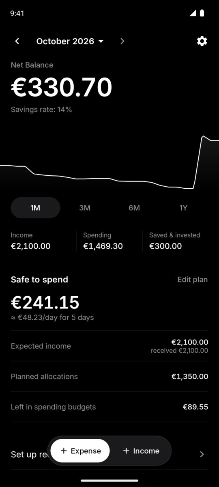
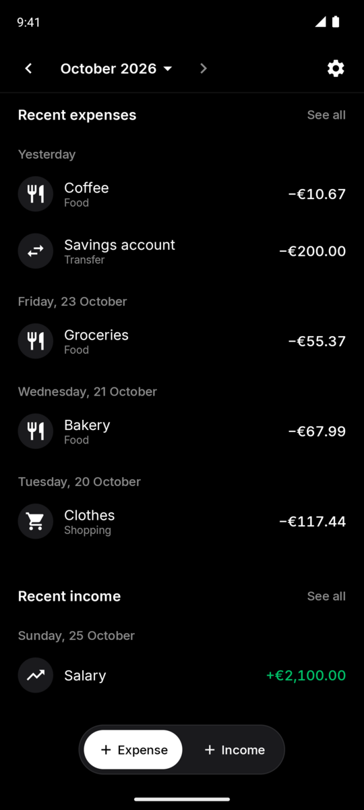
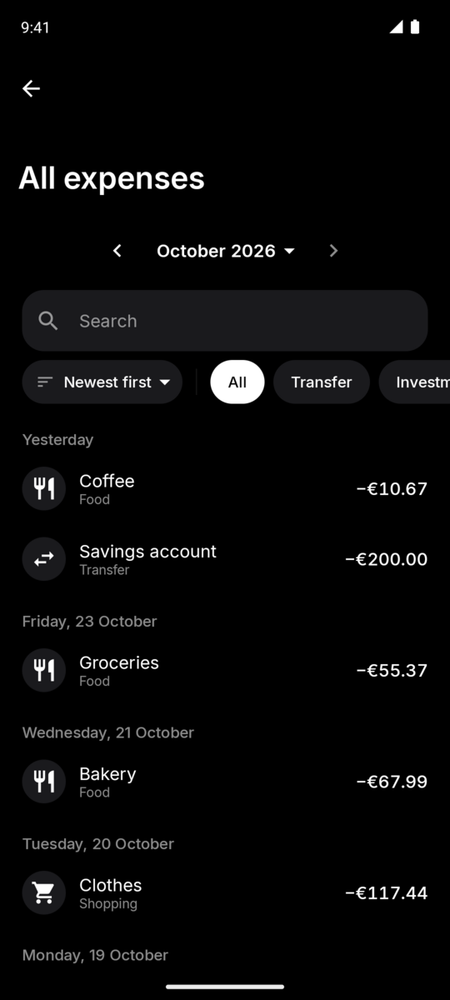

# FinTrack

[](https://github.com/joaoeoneves/fintrack/actions/workflows/ci.yml)
[](LICENSE)


<p align="center">
  
  
  
  
</p>

A monthly expense- and income-tracking Android app, built with Kotlin, Jetpack Compose and Firebase.

---

## Table of contents

- [The app](#the-app)
  - [Features](#features)
  - [Tech stack](#tech-stack)
  - [Architecture](#architecture)
  - [Data model](#data-model--firestore)
  - [Download](#download)
  - [Getting started](#getting-started)
  - [Common commands](#common-commands)
  - [Testing](#testing)
  - [CI](#ci)
- [License](#license)

---

## The app

### Features

- **Expense tracking** — add/edit/delete expenses with a name, amount, category, date, and an optional
  note. Five built-in categories (Transfer, Investments, Shopping, Food, Recurring) plus your own.
- **Income tracking** — a separate, parallel entity (free-text source like "Salary" or "Freelance" instead
  of a fixed category), kept intentionally independent of expenses so it could be added later with zero
  risk to the existing expense code.
- **Dashboard** — a large **net balance** (income minus expenses) that counts up on change, a minimal
  cumulative-balance line chart you can long-press and scrub (with haptic ticks), 1M / 3M / 6M / 1Y period
  tabs plus month navigation and custom ranges, an income / spending / saved strip, a category breakdown
  (segmented bar + ranked list), and the latest expenses and income grouped by day.
- **Per-category budget limits** — set a monthly limit per category; the Dashboard shows progress bars
  against the current calendar month (independent of the rolling time-range filter) with an over-budget
  visual state.
- **Monthly plan / "safe to spend"** — list your expected income (e.g. salary, meal allowance); the
  category budgets are the planned allocations. A Dashboard card shows what's still free to spend this
  month (income minus, per category, the larger of planned and actual), expected vs received income,
  what's left in spending budgets and a daily allowance; the category breakdown toggles between actual and
  planned. Edited on its own "Monthly plan" screen.
- **Recurring transactions** — rent, subscriptions, salary: monthly or yearly templates with an explicit
  billing day (clamped to short months), start/end dates and pause/resume. An Upcoming card on the
  Dashboard lists due and soon-due occurrences with one-tap Confirm (creates the expense/income with a
  deterministic id, so it's never duplicated) or Skip, and shows the annualized cost of recurring expenses.
- **Full expense/income lists** — the same time-range filters, text search, and sorting (newest/oldest
  first, highest/lowest amount), rows grouped under day headers; swipe-to-delete with an Undo snackbar
  (also exposed as a "Delete" accessibility action).
- **CSV import/export** — for expenses, from Settings (income CSV support is a deliberate fast-follow, not
  yet built).
- **Google Sign-In** via Credential Manager (not the legacy `GoogleSignInClient` API) + Firebase Auth.
- **Guest mode** — "Continue as guest" uses the full app with everything stored only on the device (one
  JSON file, no Firebase). Signing in later offers to copy the guest data into the account (categories
  with the same name are merged, nothing is duplicated, an interrupted copy can be retried), then to
  remove it from the device.
- **JSON backup** — export all data and preferences to a versioned `fintrack-backup` JSON file (signed in
  or as a guest) and restore it as a guest, e.g. to move to another phone.
- **Settings** — reached from the Dashboard's gear icon:
  - **Theme**: system default, light or dark. The design is dark-first and monochrome (true black, hairline
    dividers, color only for meaning: gains, overspending, category data), set in Inter with tabular
    figures, with shared-axis screen transitions and motion that respects the system's reduced-motion
    setting.
  - **Language**: English or Portuguese (or the system language), switched in-app. Theme, language and
    currency are stored locally (DataStore) and synced across your devices through Firestore.
  - **Display currency**: USD, EUR, GBP, JPY, CAD or AUD. Purely cosmetic: it changes the symbol and
    formatting, with no exchange-rate conversion.
  - **Categories**: add your own (name, icon, color, spending or saving), rename/recolor the built-ins,
    reorder, archive (hidden from pickers, kept on existing data) or delete unused ones.
  - CSV import/export, JSON backup, and the account (or guest) card.
- **Offline-friendly** — for signed-in users Firestore's built-in local cache is the only persistence
  layer (no Room), so data survives offline use and syncs back once reconnected; guest data is local by
  design.

### Tech stack

| Layer | Choice |
|---|---|
| Language | Kotlin 2.4 |
| UI | Jetpack Compose + Material 3 |
| Architecture | MVVM — ViewModels hold state/logic, composables stay declarative |
| Async | Coroutines + `Flow`, `StateFlow` for UI state (`collectAsStateWithLifecycle`) |
| DI | Hilt |
| Navigation | Compose Navigation, type-safe routes |
| Auth | Firebase Auth + Google Sign-In via `androidx.credentials` (Credential Manager) |
| Persistence | Firebase Firestore when signed in; a kotlinx.serialization JSON file in guest mode (no Room either way) + Preferences DataStore for theme/currency/language and session state |
| Lint/format | ktlint + detekt |
| Unit tests | JUnit4 + Robolectric (where Android framework classes are needed, e.g. the legacy `SharedPreferences` migration) |
| E2E tests | [Maestro](https://maestro.mobile.dev) |
| Typeface | [Inter](https://rsms.me/inter/) (bundled static TTFs) |
| CI | GitHub Actions |

Min SDK 24, target/compile SDK 36, Java 11 source/target compatibility.

### Architecture

Single module (`:app`), package `com.joaoeoneves.fintrack`, organized as:

```
app/src/main/java/com/joaoeoneves/fintrack/
├── ui/            Compose screens and components (dashboard, expense/, income/, auth/, theme/, ...)
├── data/          Repository implementations: Firestore, local/ (guest JSON store), session/ (switches
│                  between them), backup/, migration/, preferences/, CSV import/export
├── domain/        Domain models and repository interfaces
├── di/            Hilt modules
app/src/test/          Unit tests (JVM, mirrors the app/src/main package structure)
app/src/androidTest/   Instrumented tests
.maestro/              E2E flows (YAML), run against a real emulator/device
```

Each repository has a Firestore-backed implementation, a local JSON-backed implementation for guest mode
(`data/local/`) and a `Fake*` in-memory implementation (unit tests only). Hilt binds the domain interfaces
to `Session*Repository` delegates (`data/session/`) that route every call to the local or Firestore
implementation for the current session, so ViewModels don't know which one they're using and a guest never
instantiates Firestore. Cross-cutting state (auth, theme preference) is
resolved once in `MainActivity` and threaded down through the nav graph as plain callback/value parameters
— not re-resolved via `hiltViewModel()` inside individual nav destinations, which could otherwise pick up a
different, nav-entry-scoped instance.

### Data model (Firestore)

```
users/{uid}/expenses/{expenseId}
  name: string
  amountCents: number       // integer minor units, always > 0 — avoids float rounding errors
  category: string          // category id: a built-in (TRANSFER | INVESTMENTS | SHOPPING | FOOD |
                            // RECURRING) or a users/{uid}/categories document id
  isRefund: boolean         // optional, absent = false; a refund subtracts from its category
  date: timestamp
  note: string | null
  createdAt / updatedAt: timestamp

users/{uid}/income/{incomeId}
  source: string            // free text, e.g. "Salary", "Freelance" — not a fixed enum
  amountCents: number
  date: timestamp
  note: string | null
  createdAt / updatedAt: timestamp

users/{uid}/budgets/{categoryId}
  limitCents: number
  updatedAt: timestamp

users/{uid}/plannedIncome/{lineId}    // expected-income lines of the monthly plan (max 10, client-side)
  label: string             // 1..50 chars
  amountCents: number
  order: number
  updatedAt: timestamp

users/{uid}/recurring/{itemId}        // recurring expense/income templates
  type: string              // EXPENSE | INCOME
  name: string              // 1..200 chars (expense name / income source)
  amountCents: number
  category: string | null   // EXPENSE only
  note: string | null
  frequency: string         // MONTHLY | YEARLY
  dayOfMonth: number        // 1..31, clamped to the month's length
  monthOfYear: number|null  // 1..12, YEARLY only
  startDate / endDate: string        // yyyy-MM-dd; endDate optional, inclusive
  handledThrough: string | null      // last confirmed/skipped occurrence (cursor)
  active: boolean
  updatedAt: timestamp
// Confirming an occurrence writes expenses|income/rec_<itemId>_<yyyyMMdd> and advances the cursor in one batch.

users/{uid}/categories/{categoryId}   // user categories (generated ids) and optional overrides
  name: string | null       //   of the built-ins (same id; null name = localized default)
  iconKey / colorKey: string
  kind: string              // SPENDING | SAVING
  order: number
  archived / builtIn: boolean
  createdAt / updatedAt: timestamp

users/{uid}/settings/preferences       // theme, currency and language, synced across devices
  theme: string             // SYSTEM | LIGHT | DARK
  currency: string          // USD | EUR | GBP | JPY | CAD | AUD
  language: string          // SYSTEM | ENGLISH | PORTUGUESE
  updatedAt: timestamp
```

Security rules ([`firestore.rules`](firestore.rules)) restrict every collection to
`request.auth.uid == userId` — a user can only ever read/write their own documents.

### Local data file / backup format

Guest data lives in `filesDir/guest-data.json` (`LocalDataDocument`: `schemaVersion`, `revision`, and lists
of expenses, income, budgets and categories mirroring the Firestore documents, with ISO-8601 dates). Writes
are atomic (temp file + rename); a corrupt or newer-schema file is moved aside to
`guest-data.corrupt-<millis>.json` rather than deleted. After a successful "Remove from this device" following a migration to an account,
the previous file is kept once as `guest-data.migrated.json` (a single safety copy, overwritten next time). The backup file uses the same record shapes inside
a `{ "format": "fintrack-backup", "schemaVersion": 3, "exportedAt", "appVersion", "preferences", ... }`
envelope; records that fail validation are skipped and reported on restore.

### Download

A debug-signed APK of the latest version is attached to the
[latest release](https://github.com/joaoeoneves/fintrack/releases/latest) (Android 7.0+).

### Getting started

1. **Firebase project**: create one, register an Android app with package `com.joaoeoneves.fintrack`,
   enable Google Sign-In in Authentication, create a Firestore database, and deploy `firestore.rules`.
   Download `google-services.json` into `app/` — it's gitignored and never committed (CI uses a
   placeholder; see [CI](#ci)).
2. **SHA-1**: add your debug (and release) signing certificate's SHA-1 to the Firebase Android app config
   (required for Google Sign-In) — `./gradlew signingReport` prints it.
3. **JDK 21** and `ANDROID_HOME` pointing at an installed Android SDK.
4. Build and run:
   ```
   ./gradlew assembleDebug
   ./gradlew installDebug   # with a device/emulator connected
   ```

### Common commands

Run from the repository root via the Gradle wrapper:

| Command | Purpose |
|---|---|
| `./gradlew assembleDebug` | Build debug APK |
| `./gradlew assembleRelease` | Build release APK |
| `./gradlew installDebug` | Install debug build on a connected device/emulator |
| `./gradlew test` | Run JVM unit tests (`app/src/test`) |
| `./gradlew test --tests "..."` | Run a single unit test |
| `./gradlew connectedAndroidTest` | Run instrumented tests (needs a connected device/emulator) |
| `./gradlew ktlintCheck` | Lint (formatting) |
| `./gradlew detekt` | Lint (static analysis) |
| `./gradlew check` | Full check: lint + tests |
| `./gradlew clean` | Clean build outputs |

### Testing

Three layers, deliberately kept separate:

1. **Unit tests** (`app/src/test`) — JVM, run against `Fake*Repository` implementations, no device needed.
   Robolectric is used where a real Android framework class is unavoidable (e.g. the legacy `SharedPreferences` migration).
2. **Instrumented tests** (`app/src/androidTest`) — on-device/emulator, currently minimal; most real
   on-device verification happens through Maestro instead (see below).
3. **Maestro E2E flows** (`.maestro/*.yaml`) — YAML flows driven against a real emulator, using semantic
   element matching (by visible text/content-description) rather than brittle coordinates or resource IDs.
   Run with `maestro test .maestro/<flow>.yaml`. Existing flows: `golden-path.yaml` (add expense → dashboard → full list → edit →
   delete → filters), `income-tracking.yaml` (income add → net balance → delete/undo), `settings.yaml`
   (theme and currency switching), `date-field.yaml` (date picker) and `swipe-delete-check.yaml`
   (swipe-to-delete and Undo). All of them start from an already signed-in session, since Google Sign-In
   can't be scripted headlessly.

### CI

[`.github/workflows/ci.yml`](.github/workflows/ci.yml) runs on every push/PR to `main`: checkout → JDK 21 →
Gradle → `ktlintCheck` → `detekt` → `testDebugUnitTest` → `assembleDebug`. Since `app/google-services.json`
is a real, gitignored credential, CI writes a shape-compatible **placeholder** (fake project ID, fake OAuth
client, fake API key) as a workflow step — just enough for the `google-services` Gradle plugin's presence
check and for compiling, since unit tests run against Fake repositories and never make real Firestore
calls. Instrumented/Maestro tests are intentionally kept out of this CI job (booting an emulator in CI is
slow and flake-prone) and are run manually instead.

---

## License

[MIT](LICENSE) © 2026 João Neves

The bundled typeface is [Inter](https://github.com/rsms/inter) by Rasmus Andersson, licensed under the
SIL Open Font License 1.1 (see [`third_party/inter/OFL.txt`](third_party/inter/OFL.txt)).
