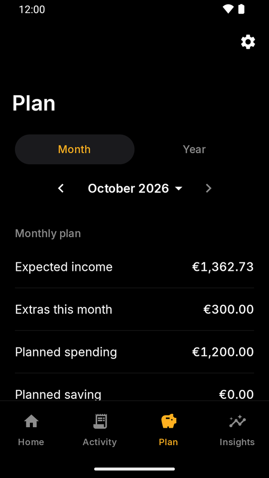
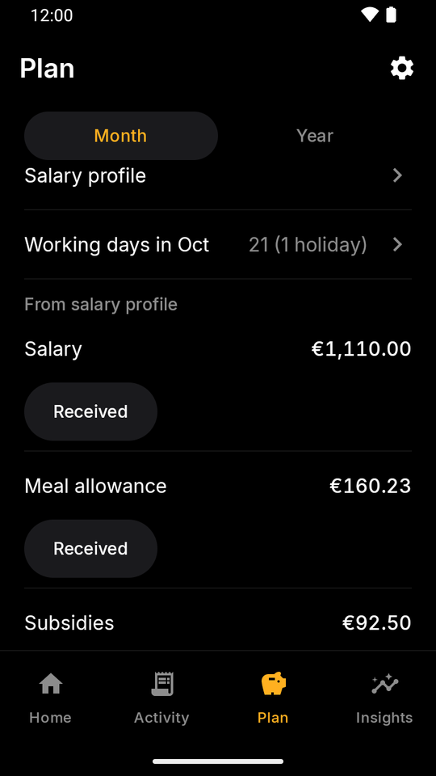
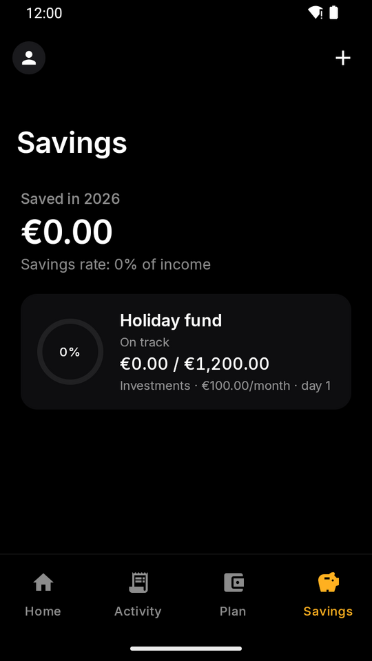
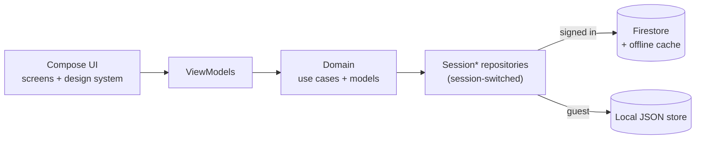

<p align="center">
  
</p>

<h1 align="center">FinTrack</h1>

<p align="center">
  A monthly money-planning app for Android: plan the month, see what is safe to spend, and keep
  recurring bills under control.
</p>

<p align="center">
  <a href="https://github.com/joaoeoneves/fintrack/actions/workflows/ci.yml"></a>
  <a href="https://github.com/joaoeoneves/fintrack/releases/latest"></a>
  <a href="LICENSE"></a>
  
  
</p>

<p align="center">
  
  
  
  
  
  
</p>

## Why

FinTrack started as a personal replacement for a monthly budgeting spreadsheet. The spreadsheet answered
one question: *given what I earn and what is already committed, how much can I still spend this month?*
The app keeps that idea at its centre: you list expected income, split spending into envelopes, add
the recurring bills, and the dashboard shows what is safe to spend and a daily allowance. It works fully
offline-first, and it can be used without an account at all (guest mode).

## Features

**Tracking**
- Expenses (name, amount, category, date, note) and income (free-text source), each with search, sorting,
  period filters and swipe-to-delete with undo. Refunds subtract from their category.
- Dashboard with net balance, a cumulative-balance chart you can scrub, 1M / 3M / 6M / 1Y tabs, month
  navigation and custom ranges, and a category breakdown.
- Categories: five built-ins plus your own (name, icon, colour, spending or saving), with rename,
  reorder, archive and delete.
- CSV import/export for expenses.

**Planning**
- Tabs: Home, Activity, Plan and Savings. An avatar with your initial opens Account & settings.
- **Envelopes**: a name, its categories and a monthly amount (one amount or the sum of per-category
  limits), with progress on Plan. An envelope can also be "no budget" and only track spending. What is
  left after income, bills, savings and envelopes is shown as *Free*, with a daily allowance. A yearly
  view shows all twelve months.
- **Income** in one place: the salary profile plus your own income lines. Any line can be recorded
  automatically on its pay day (last working day, with Portuguese holidays, or a fixed day). Income can
  be per working day, with days off and a Carnival shortcut.
- Salary profile (optional): a three-step set-up (gross or net, subsidies, meal allowance), with the full
  form under Advanced for youth IRS, deductions and your own extras (a fixed amount, a multiple of the
  base or a share of the annual gross, paid in the months you choose). Each component gets its own income
  row.
- **Savings plans** on the Savings tab: a monthly amount, a day and a category, recorded automatically,
  with an optional target per year or in total. A goal is a plan without a monthly amount. The tab also
  shows the amount saved this year and the savings rate.
- A **Get started** checklist on Home walks through the set-up and hides when done.
- When you add an expense, the category you used last time for that name is suggested.

**Activity**
- One list of expenses and income with search, sorting and period filters. Delete by swiping, or from
  the edit screen, with undo.
- A summary header: 1M / 3M / 6M / 1Y tabs or a custom range, the total spent, fixed versus variable,
  spending by envelope with filter chips, and a breakdown by category or envelope.

**Bills**
- Monthly or yearly recurring expenses (rent, subscriptions) with start and end dates and pause/resume.
- An Upcoming card lists the bills that are due. Confirm records the expense and Skip moves on. Confirming
  twice (a double tap, or a second device) never creates a duplicate. A bill can also be posted
  automatically on its due date.

**Guest mode and backup**
- "Continue as guest" uses the whole app with data kept in a single JSON file on the device; no Firebase
  is involved.
- Signing in later offers to copy guest data into the account, then to remove it from the device.
- Versioned JSON backup and restore (for example to move to another phone), for guests and signed-in
  accounts. Restoring into an account offers to export a backup first. A "delete all data" action is
  also available.

**Localization and appearance**
- English and Portuguese (pt-PT), switchable in-app; follows the system language by default.
- System, light or dark theme, and a Reduce animations option. Motion includes smooth transitions,
  predictive back, counting amounts, skeleton loading and haptics.
- Display currency (USD, EUR, GBP, JPY, CAD, AUD) is cosmetic, with no
  exchange-rate conversion.

**Privacy-relevant bits**
- Sign-in is Google via Credential Manager; data is stored under your own user id and Firestore security
  rules restrict every document to its owner (see [SECURITY.md](SECURITY.md)).
- Guest data never leaves the device unless you export a backup.

## Download and install

Signed APKs are attached to each [GitHub release](https://github.com/joaoeoneves/fintrack/releases/latest)
(Android 8.0+). To get updates automatically, add `https://github.com/joaoeoneves/fintrack` as a source in
[Obtainium](https://obtainium.imranr.dev/).

v1.0 was signed with a debug key, so moving to the signed builds requires uninstalling the app once. This
clears local (guest) data; Firestore data is unaffected.

## Tech stack

| Area | Choice |
|---|---|
| Language | Kotlin 2.4.10 |
| UI | Jetpack Compose (BOM 2026.06.01) with Material 3 and a small in-house design system (`ui/designsystem`), Inter typeface |
| Architecture | MVVM, `StateFlow` UI state, type-safe Compose Navigation 2.9 |
| Async | Coroutines 1.11 and `Flow` |
| DI | Hilt 2.60 with KSP |
| Backend | Firebase Auth (Google Sign-In through `androidx.credentials`) and Firestore (BoM 34.16) with its offline cache |
| Local storage | JSON file via kotlinx.serialization 1.11 (guest mode), Preferences DataStore 1.3 (settings, session) |
| Performance | R8 minification, Baseline Profiles (`:baselineprofile` module), splash screen API |
| Quality | ktlint, detekt, Android lint, JUnit 4, Robolectric, Maestro |
| Build | AGP 9.3, Gradle version catalog, GitHub Actions, Dependabot |

## Architecture



ViewModels depend only on repository interfaces from `domain/`. Hilt binds each interface to a
`Session*Repository` that routes every call to the Firestore or the local JSON implementation for the
current session, so UI code does not know which one is in use and a guest never creates Firestore.
Details, the data model and the rules approach are in [docs/ARCHITECTURE.md](docs/ARCHITECTURE.md);
the reasoning behind the main choices is in [docs/DECISIONS.md](docs/DECISIONS.md).

## Quality

- **2,700+ unit tests** (JVM, run against in-memory fake repositories; Robolectric where an Android
  class is unavoidable).
- **JVM screen tests** (Robolectric + Compose) drive the main flows on every PR, with no emulator.
- **Maestro E2E flows** (`.maestro/`, guest mode) can be run on demand from the E2E workflow or by hand.
- **CI** on every push and PR to `main`: ktlint, detekt, Android lint, unit tests, debug and (unsigned)
  release builds, and compilation of the baseline-profile generator.
- **Baseline profile** generated on a CI emulator and committed.
- **Signed releases**: the Release workflow (run it with a version, or push a tag `vX.Y`) builds, tests
  and signs the APK, verifies the signature, and publishes a GitHub release with the APK and the R8
  mapping file.

Run the same checks locally with the shared gate script:

```bash
scripts/gate.sh fast                 # ktlint + detekt + unit tests
scripts/gate.sh fast 'com.joaoeoneves.fintrack.ui.recurring.*'   # filtered unit tests
scripts/gate.sh full                 # everything CI checks, plus androidTest compilation
```

## Getting started

Requires JDK 21 and an Android SDK (`ANDROID_HOME`).

1. Clone the repository.
2. Create a Firebase project, register an Android app with package `com.joaoeoneves.fintrack`, enable
   Google Sign-In, create a Firestore database and deploy [`firestore.rules`](firestore.rules).
3. Put your own `google-services.json` in `app/` (it is gitignored) and add your debug certificate's
   SHA-1 to the Firebase app (`./gradlew signingReport` prints it).
4. Build and run:

   ```bash
   ./gradlew installDebug
   ```

Guest mode works without any Firebase sign-in, but the build still needs a `google-services.json`
(CI uses a placeholder one).

## Project structure

```
app/src/main/java/com/joaoeoneves/fintrack/
├── ui/        Compose screens by feature (dashboard, expense, income, plan, recurring, settings, ...),
│              designsystem/, theme/, navigation/
├── data/      Firestore repositories, local/ (guest JSON store), session/ (switching), backup/,
│              migration/, preferences/, csv/, automation/ and salary/ (app-start syncs)
└── di/        Hilt modules
core/model/            pure-Kotlin module: domain models, repository interfaces, use cases
app/src/test/          JVM unit tests and shared fakes
app/src/androidTest/   instrumented tests
baselineprofile/       baseline profile generator module
.maestro/              Maestro E2E flows
firestore.rules        Firestore security rules
scripts/gate.sh        shared quality gate
```

## Roadmap

- Income CSV import/export (expenses are supported today).
- Further polish of the planning and recurring screens based on day-to-day use.
- Broader instrumented-test coverage.

## Contributing

See [CONTRIBUTING.md](CONTRIBUTING.md). Changes are listed in [CHANGELOG.md](CHANGELOG.md).

## License

[MIT](LICENSE) © 2026 João Neves.

The bundled typeface is [Inter](https://github.com/rsms/inter) by Rasmus Andersson, licensed under the
SIL Open Font License 1.1 (see [`third_party/inter/OFL.txt`](third_party/inter/OFL.txt)).
