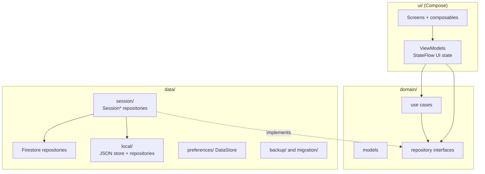
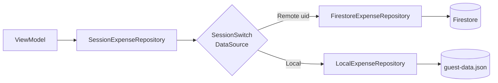
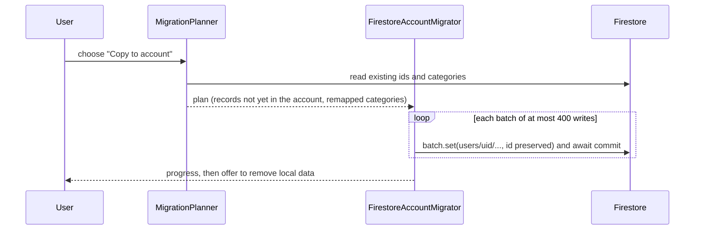

# Architecture

FinTrack is an Android app (`:app`, package `com.joaoeoneves.fintrack`) with a pure-Kotlin `:core:model`
module (see Modules below) plus a `:baselineprofile` module that generates the baseline profile. It is MVVM on Jetpack Compose, with Hilt
for dependency injection and Coroutines/`Flow` for async work.

## Modules

| Module | Contents |
|---|---|
| `:core:model` | Pure Kotlin/JVM (no Android): `domain/model`, `domain/repository` (except `AuthRepository`/`SessionRepository`, which take an Android `Context` for sign-in and stay in `:app`), `domain/usecase` and the `@IoDispatcher` qualifier. Depends only on coroutines and `javax.inject`; packages are unchanged. Its unit tests run on the plain JVM (`:core:model:test`). |
| `:app` | Everything else: UI, data, DI, the Hilt application. Depends on `:core:model`. |
| `:baselineprofile` | Baseline profile generator, targets `:app`. |

ktlint and detekt run per module and share `app/config/detekt/detekt.yml`; the root `ktlintCheck`/`detekt` tasks aggregate them.

## Layers and packages

| Package | Responsibility |
|---|---|
| `ui/` | Compose screens per feature (`dashboard`, `expense`, `income`, `plan`, `recurring`, `settings`, `auth`, `backup`, `migration`, `importexport`), shared pieces (`common`), `navigation` (central graph with type-safe routes), `theme` |
| `ui/designsystem/` | Reusable building blocks: buttons, text fields, amount input, animated amount text, segmented tabs, settings rows, transaction row, dialogs, snackbar, empty state, large-title scaffold |
| `domain/` | Models (`Expense`, `Income`, `Category`, `RecurringItem`, `MonthlyPlanSummary`, `Period`, ...), repository interfaces, and use cases such as `ObservePeriodOverview`, `ObserveUpcomingRecurring`, `HandleRecurringOccurrence` |
| `data/` | Firestore repositories, `local/` guest store, `session/` switching, `backup/`, `migration/`, `preferences/`, `csv/` |
| `di/` | Hilt modules binding interfaces to implementations, dispatchers, the guest data file and the clock |

State rules: UI state is a `StateFlow` in the ViewModel, collected with `collectAsStateWithLifecycle`;
`remember`/`mutableStateOf` is used only for local, ephemeral UI state. Navigation arguments travel
through routes, not shared state.

## Session-switched repositories

Every repository interface in `domain/repository/` has up to three implementations:

- a Firestore-backed one (`data/Firestore*Repository`),
- a local one for guest mode (`data/local/Local*Repository`),
- an in-memory fake used only by tests.

Hilt binds each interface to a `Session*Repository` (`data/session/`). It holds a `SessionSwitch`, which
observes the current `Session` (loading, guest, signed out, signed in) and picks the implementation:

- Flows re-subscribe (`flatMapLatest`) when the data source changes, for example after sign-in.
- One-shot calls wait for the session to resolve before choosing.
- The Firestore repository is injected as `dagger.Lazy`, so a guest never instantiates Firestore.
- If a local flow fails (for example an unreadable file) the failure is logged and an empty result is
  emitted, mirroring how the Firestore repositories degrade.

## Firestore data model

All data lives under `users/{uid}/`. Money is stored as integer minor units (`amountCents`), never floats.

| Path | Fields (summary) |
|---|---|
| `expenses/{id}` | `name`, `amountCents` (> 0), `category` (category id), `isRefund?`, `date`, `note?`, `createdAt`, `updatedAt` |
| `income/{id}` | `source` (free text), `amountCents`, `date`, `note?`, timestamps |
| `budgets/{categoryId}` | `limitCents` (the document id is the category id), `skipMonths?` (months 1..12 the limit does not apply to) |
| `plannedIncome/{lineId}` | `label` (1..50), `amountCents` (the rate for per-working-day lines), `order`, `basis?` (`FIXED`/`PER_WORKING_DAY`), `frequency?` (`MONTHLY`/`YEARLY`/`ONCE`), `monthOfYear?` (yearly only), `yearMonth?` (`yyyy-MM`, one-off only), `skipMonths?` (list of months 1..12 a monthly line is not paid in), `earmarkType?` (`CATEGORY`/`GROUP`) + `earmarkId?` (both or neither: sets the line aside for that category/group as a pot), `managedKey?` (one of the `profile_*` keys: the line is generated from the salary profile, read-only except label/earmark); absent fields mean fixed/monthly; at most 20 lines (enforced client-side, rules cannot count documents) |
| `plan/salaryProfile` | singleton: `inputMode` (`GROSS`/`NET`), rates as integer ppm (`subsidySpreadPpm` 0/500000/1000000, `irsBasePpm`, `irsSubsidiesPpm?`, `ssPpm`, `irsJovemExemptPpm`), amounts in cents (`baseGrossCents?`, `netMonthlyCents?`, `netHolidayLumpCents?`, `netChristmasLumpCents?`, `mealRatePerDayCents?`), months 1..12 (`holidaySubsidyMonth`, `christmasSubsidyMonth`), `mealSkipMonths`, `extras` (list of up to 10 `{id, name, amountType` FIXED_CENTS/MULTIPLE_OF_BASE_PPM/PERCENT_OF_ANNUAL_GROSS_PPM`, amount, months, deductions?, feePpm?}`; absent = legacy `flex*`/`profitShare*`/`bonus*` fields migrated on read), `updatedAt`; saving it upserts the managed `plannedIncome` lines, deleting it removes them |
| `plan/automation` | singleton: `paydayEnabled?` (record the planned income on payday), `paydayThrough?` (`yyyy-MM`, the last month already recorded), `updatedAt` |
| `categoryGroups/{id}` | `name` (1..50), `order`, `updatedAt`; categories point at one with the optional `groupId` (shape-checked only, a dangling id means ungrouped); deleting a group clears `groupId` on its categories |
| `goals/{id}` | `name` (1..50), `targetCents`, `targetType` (`ANNUAL`/`TOTAL`), `startDate`, `targetDate?` (not before `startDate`), `initialCents?` >= 0, `linkedRecurringIds?` (list, at most 20), `linkedCategoryId?` (shape-checked only), `archived`, `order`, `updatedAt`; progress is computed from the expenses of the linked recurring items (id prefix `rec_<itemId>_`) and category |
| `monthSettings/{yyyy-MM}` | `workingDays?` 0..23 (manual working-days count replacing the Portuguese-holiday calendar count for that month), `daysOff?` 0..23 (vacation/days off taken; effective working days = override, else calendar count minus days off); the document is deleted when neither is set; `updatedAt` |
| `recurring/{itemId}` | `type` (`EXPENSE`/`INCOME`), `name`, `amountCents`, `category?`, `note?`, `frequency` (`MONTHLY`/`YEARLY`), `dayOfMonth` 1..31, `monthOfYear?`, `startDate`, `endDate?`, `handledThrough?`, `active`, `autoPost?`, `updatedAt` (dates as `yyyy-MM-dd`) |
| `categories/{id}` | `name?`, `iconKey`, `colorKey`, `kind` (`SPENDING`/`SAVING`), `order`, `archived`, `builtIn`, timestamps. User categories have generated ids; a built-in's override document reuses the built-in id with `name` null meaning the localized default |
| `settings/preferences` | `theme` (`SYSTEM`/`LIGHT`/`DARK`), `currency` (`USD`/`EUR`/`GBP`/`JPY`/`CAD`/`AUD`), `language` (`SYSTEM`/`ENGLISH`/`PORTUGUESE`), `updatedAt` |

Built-in category ids are `TRANSFER`, `INVESTMENTS`, `SHOPPING`, `FOOD` and `RECURRING`.

## Security rules

[`firestore.rules`](../firestore.rules) follows three principles:

1. **Owner-only.** Every collection is reachable only when `request.auth.uid == userId`.
2. **Allowlisted, typed fields.** Each create/update must pass a validator that uses
   `data.keys().hasOnly([...])` and `hasAll([...])` plus type and range checks (positive integer amounts
   up to 1,000,000,000.00, string length limits, date shapes, enum values). A modified client cannot add
   unknown fields or write a negative amount.
3. **Referential checks.** An expense's category must be a built-in id or a category document of the same
   user (`existsAfter`, so one batch can create a category and use it). Budgets and recurring expenses
   follow the same rule.

The client mirrors these limits (`FieldLimits`, local record validation) so invalid input is rejected
before a write, and the rules remain the authority. Adding an enum value in the app requires deploying
the rules first.

## Offline-first writes

Firestore's persistent local cache is the only persistence layer for signed-in users (no Room). Write
operations such as add/update/delete are deliberately **not awaited**: the write lands in the local cache
immediately and syncs when the device is online, whereas awaiting would hang until server
acknowledgement while offline. Reads are snapshot listeners wrapped in `callbackFlow`.

## Guest mode: the local JSON store

`LocalDataStore` holds the guest data set (`LocalDataDocument`: `schemaVersion`, `revision`, and lists of
expenses, income, budgets, planned income, categories, recurring items, month settings, category groups, salary profile, goals, automation settings; ISO-8601 dates) in
`guest-data.json` under `filesDir`.

- Loaded lazily, kept in memory, rewritten on every change.
- **Atomic writes**: temp file, fsync, rename. New state is published to observers only after the write
  succeeded, so no one sees data that is not on disk. A mutex serialises writers.
- **Versioning**: `schemaVersion` is currently 12. A corrupt file, or one with a newer schema, is moved to
  `guest-data.corrupt-<millis>.json` (never deleted) and the store starts empty.
- After a migration to an account and a confirmed "Remove from this device", one safety copy remains as
  `guest-data.migrated.json`, overwritten next time.

## Backup format

A backup is a JSON document `{ "format": "fintrack-backup", "schemaVersion": 12, "exportedAt",
"appVersion", "preferences", ...records }` using the same record shapes as the guest store. Decoding:

- a missing or invalid version is rejected; a version newer than the app supports is refused;
- older versions are upgraded in memory to the current one;
- records that fail validation are skipped and reported to the user on restore.

Backups can be exported signed in or as a guest and restored as a guest.

## Guest to account migration

When a guest signs in and there is local data, the app offers to copy it into the account
(`data/migration/`).

- **Idempotent**: ids are preserved and records already present in the account are left out of the plan,
  so an interrupted copy can simply be retried; earlier committed batches are skipped the second time.
- **Category merge**: categories with the same name are merged rather than duplicated, and records are
  remapped to the account's category ids. Records that cannot be migrated are counted as skipped.
- **Rules-aware batching**: a batch has at most 400 writes (the hard limit is 500) and references at most
  15 distinct custom categories, because each custom-category reference costs a rules lookup and a batched
  write may do at most 20 document-access calls. Categories are committed first so later batches find them.
- Unlike normal writes, the migrator awaits each commit, since the user must know the data reached the
  server before offering to delete it locally.

## Recurring transactions

A `RecurringItem` is a template (monthly or yearly, a billing day clamped to the month length, start and
optional end date, pause flag). A `handledThrough` cursor records the last confirmed or skipped
occurrence; `ObserveUpcomingRecurring` derives the due and soon-due occurrences from the cursor.

Confirming an occurrence creates the expense or income with a **deterministic id**,
`rec_<itemId>_<yyyyMMdd>`, and advances the cursor in the same atomic write. Because the id is a pure
function of the item and date, a double tap or a second device writes the same document instead of a
duplicate; `HandleRecurringOccurrence` also re-reads the latest item and treats an already-handled
occurrence as a successful no-op. Skipping only advances the cursor.

Items with `autoPost` set go through the same path without a tap: `AutoPostRecurring` confirms every
occurrence that is due, so the deterministic id keeps it safe if two devices do it at once.

## Monthly plan

The plan is global (one set of expected-income lines) and built on the category budgets. For a month
(`monthlyPlanOf` in `domain/model/MonthlyPlan.kt`):

- `expectedIncome` = sum of planned income lines; `actualIncome` = income dated in that month.
- `incomeBasis` = max(expected, actual).
- `committed` = over all categories, the larger of its limit (or 0) and what was actually spent.
- `safeToSpend` = `incomeBasis - committed`; negative means the plan is overrun.
- Daily allowance = `safeToSpend / days left` (today included), shown only for the current month and only
  while something is left.

Budgets of saving-kind categories count as committed money but not as spending budget.

**Pots** (`potsOf` in `domain/model/Pots.kt`, optional): a monthly income line can be earmarked for a category
or a group. Each target gets a pot whose income is the sum of its lines; its categories' committed money is
charged to the pot (a category earmark beats a group earmark), everything else to the *base*. A pot's
`free` = income - committed; a deficit spills into the base, a surplus stays in the pot. The base income is
max(non-earmarked expected, actual month income - earmarked expected), and the daily allowance applies to the
base. Without earmarks the base equals the safe-to-spend above. An earmark whose target no longer exists is
ignored.

## App-start syncs

Two singletons run when the app starts and follow the session. `ManagedIncomeSync` (`data/salary/`)
re-generates the income lines managed by the salary profile, so a rule or holiday change shows up without
re-saving the profile. `AutomationSync` (`data/automation/`) runs `AutoPostRecurring` and `RecordPayday`
whenever the session, the data they read or the foreground state changes, which is how a new day is picked
up without a background job. Payday is the last working day of the month (Portuguese holidays); the
`paydayThrough` cursor in `plan/automation` stops a month being recorded twice, and the "Received" action
on Plan and Home runs the same step early. A failing step is logged and not retried for the same inputs.

## Localization

English is the default resource set; Portuguese (pt-PT) lives in `values-pt-rPT`. The in-app language
picker (System, English, Portuguese) uses AppCompat per-app locales, which is why `MainActivity` extends
`AppCompatActivity`; the locale list is generated (`generateLocaleConfig`). Built-in category names are
localized and reserved in every language so users cannot create a clashing name. Language, theme and
currency are kept in DataStore and, when signed in, synced through `settings/preferences`.

## Theming and design system

`FinTrackTheme` provides colours, typography (bundled Inter with tabular figures), shapes, dimensions and
motion tokens. The look is dark-first with a gold accent, hairline dividers and colour reserved for
meaning (gains, overspending, category data). Screens compose the in-house components from
`ui/designsystem/` on top of Material 3; motion respects the system's reduced-motion setting.

## Performance

R8 is enabled for release builds. A baseline profile, generated by the `:baselineprofile` module on a CI
emulator (guest mode, so no account is needed) and committed under `app/src/main/generated`, speeds up
startup and the dashboard.
