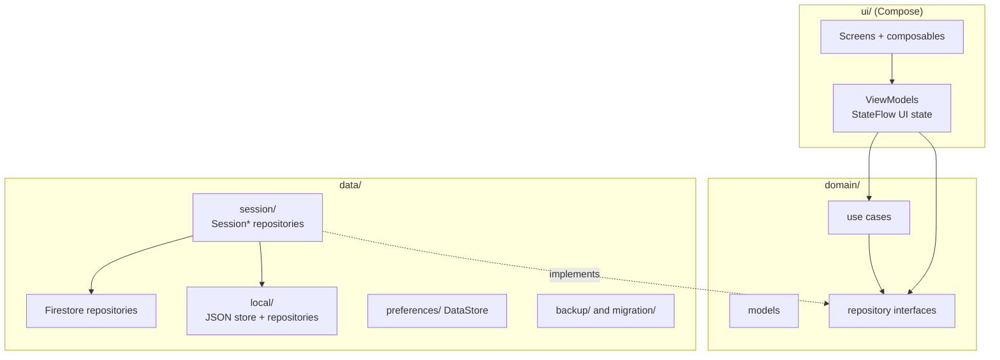
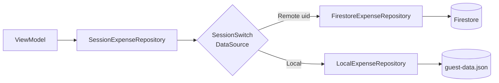
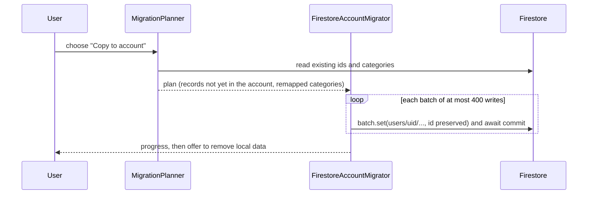

# Architecture

FinTrack is an Android app (`:app`, package `com.joaoeoneves.fintrack`) with a pure-Kotlin `:core:model`
module (see Modules below) plus a `:baselineprofile` module that generates the baseline profile. It is MVVM on Jetpack Compose, with Hilt
for dependency injection and Coroutines/`Flow` for async work.

## Modules

| Module | Contents |
|---|---|
| `:core:model` | Pure Kotlin/JVM (no Android): `domain/model`, `domain/repository` (except `AuthRepository`/`SessionRepository`, which take an Android `Context` for sign-in and stay in `:app`), `domain/usecase` and the `@IoDispatcher` qualifier. Depends only on coroutines and `javax.inject`; packages are unchanged. Its unit tests run on the plain JVM (`:core:model:test`). |
| `:app` | Everything else: UI, data, DI, the Hilt application. Depends on `:core:model`. |
| `:baselineprofile` | Baseline profile generator, targets `:app`. |

ktlint and detekt run per module and share `app/config/detekt/detekt.yml`; the root `ktlintCheck`/`detekt` tasks aggregate them.

## Layers and packages

| Package | Responsibility |
|---|---|
| `ui/` | Compose screens per feature (`dashboard`, `activity` (list, search and filters), `expense`, `income`, `plan` (envelopes, income, salary profile and `salary/setup` wizard), `savings`, `recurring`, `settings`, `auth`, `backup`, `migration`, `importexport`), shared pieces (`common`, incl. the account avatar), `navigation` (central graph with type-safe routes, `NavMotion` transitions), `theme` |
| `ui/designsystem/` | Reusable building blocks: buttons, text fields, amount input, animated amount text, progress bar and ring, skeletons, haptics, segmented tabs, settings rows, transaction row, dialogs, snackbar, empty state, large-title scaffold |
| `domain/` | Models (`Expense`, `Income`, `Category`, `RecurringItem`, `MonthlyPlanSummary`, `Period`, ...), repository interfaces, and use cases such as `ObservePeriodOverview`, `ObserveUpcomingRecurring`, `HandleRecurringOccurrence` |
| `data/` | Firestore repositories, `local/` guest store, `session/` switching, `backup/` (incl. signed-in restore and `RestoreGate`), `migration/` (guest → account copy and the 3.0 data migrations), `salary/`, `automation/`, `preferences/`, `csv/` |
| `di/` | Hilt modules binding interfaces to implementations, dispatchers, the guest data file and the clock |

State rules: UI state is a `StateFlow` in the ViewModel, collected with `collectAsStateWithLifecycle`;
`remember`/`mutableStateOf` is used only for local, ephemeral UI state. Navigation arguments travel
through routes, not shared state.

## Session-switched repositories

Every repository interface in `domain/repository/` has up to three implementations:

- a Firestore-backed one (`data/Firestore*Repository`),
- a local one for guest mode (`data/local/Local*Repository`),
- an in-memory fake used only by tests.

Hilt binds each interface to a `Session*Repository` (`data/session/`). It holds a `SessionSwitch`, which
observes the current `Session` (loading, guest, signed out, signed in) and picks the implementation:

- Flows re-subscribe (`flatMapLatest`) when the data source changes, for example after sign-in.
- One-shot calls wait for the session to resolve before choosing.
- The Firestore repository is injected as `dagger.Lazy`, so a guest never instantiates Firestore.
- If a local flow fails (for example an unreadable file) the failure is logged and an empty result is
  emitted, mirroring how the Firestore repositories degrade.

## Firestore data model

All data lives under `users/{uid}/`. Money is stored as integer minor units (`amountCents`), never floats.

| Path | Fields (summary) |
|---|---|
| `expenses/{id}` | `name`, `amountCents` (> 0), `category` (category id), `isRefund?`, `refundOf?` (a refund's original expense id, only with `isRefund`; display only, totals are unchanged, a dangling id reads as unlinked), `splitId?` (the parts of one purchase split across categories are separate expenses sharing this id; they are edited together and saved in one batch), `awaitingRefund?` (written only when true: the expense stays in To review until a refund links to it), `date`, `note?`, `createdAt`, `updatedAt` |
| `income/{id}` | `source` (free text), `amountCents`, `date`, `note?`, timestamps |
| `plannedIncome/{lineId}` | `label` (1..50), `amountCents` (the rate for per-working-day lines), `order`, `basis?` (`FIXED`/`PER_WORKING_DAY`), `frequency?` (`MONTHLY`/`YEARLY`/`ONCE`), `monthOfYear?` (yearly only), `yearMonth?` (`yyyy-MM`, one-off only), `skipMonths?` (list of months 1..12 a monthly line is not paid in), `autoRecord?` (record the line on its pay day), `payDay?` 1..31 (fixed pay day; absent = last working day), `managedKey?` (one of the `profile_*` keys: the line is generated from the salary profile, read-only except the label, `autoRecord` and `payDay`); absent fields mean fixed/monthly; at most 20 lines (enforced client-side, rules cannot count documents) |
| `plan/salaryProfile` | singleton: `inputMode` (`GROSS`/`NET`), rates as integer ppm (`subsidySpreadPpm` 0/500000/1000000, `irsBasePpm`, `irsSubsidiesPpm?`, `ssPpm`, `irsJovemExemptPpm`), amounts in cents (`baseGrossCents?`, `netMonthlyCents?`, `netHolidayLumpCents?`, `netChristmasLumpCents?`, `mealRatePerDayCents?`), months 1..12 (`holidaySubsidyMonth`, `christmasSubsidyMonth`), `mealSkipMonths`, `extras` (list of up to 10 `{id, name, amountType` FIXED_CENTS/MULTIPLE_OF_BASE_PPM/PERCENT_OF_ANNUAL_GROSS_PPM`, amount, months, deductions?, feePpm?, amountScope?` TOTAL/PER_PAYMENT, omitted = TOTAL`}`; the rules accept only those two scopes; absent = none), `raiseInFebruary?` (written only when true: a new salary amount defaults to applying from February), `updatedAt`; saving it upserts the managed `plannedIncome` lines, deleting it removes them |
| `plan/automation` | singleton: `lineThrough?` (map lineId → `yyyy-MM`, the last month each auto-record line was recorded, at most 64 entries), `updatedAt` |
| `categoryGroups/{id}` | **envelopes**: `name` (1..50), `order`, `updatedAt` (legacy `amountCents`/`fundedBy`/`startMonth`/`versions` are tolerated by the rules on update and removed on the next save); categories point at one with the optional `groupId` (a dangling id means no envelope); saving-kind categories are never part of an envelope |
| `monthSettings/{yyyy-MM}` | `vacationDays?`, `otherDays?` (each 0..23, total at most 23; effective working days = calendar count with Portuguese holidays minus the total); the document is deleted when the total is 0; `updatedAt`. A legacy `sickDays` (5.6–5.8) is added to other days on read; a legacy `daysOff` reads as vacation when no typed field exists, and a legacy `workingDays` override is ignored; both are removed on the next save |
| `recurring/{itemId}` | `type` (`EXPENSE` only), `name`, `amountCents`, `category?`, `note?`, `frequency` (`MONTHLY`/`YEARLY`), `dayOfMonth` 1..31, `monthOfYear?`, `startDate`, `endDate?`, `handledThrough?`, `active`, `autoPost` (always `true` from 5.5: a marker that the item was adopted into the automatic flow; absent or `false` means a pre-5.5 manual item, adopted on the next run without posting past occurrences), `updatedAt` (dates as `yyyy-MM-dd`) |
| `categories/{id}` | `name?`, `iconKey`, `colorKey`, `kind` (`SPENDING`/`SAVING`), `order`, `archived`, `builtIn`, timestamps. User categories have generated ids; a built-in's override document reuses the built-in id with `name` null meaning the localized default |
| `settings/preferences` | `theme` (`SYSTEM`/`LIGHT`/`DARK`), `language` (`SYSTEM`/`ENGLISH`/`PORTUGUESE`), `updatedAt` |

Built-in category ids are `TRANSFER`, `INVESTMENTS`, `SHOPPING`, `FOOD` and `RECURRING`.

## Security rules

[`firestore.rules`](../firestore.rules) follows three principles:

1. **Owner-only.** Every collection is reachable only when `request.auth.uid == userId`.
2. **Allowlisted, typed fields.** Each create/update must pass a validator that uses
   `data.keys().hasOnly([...])` and `hasAll([...])` plus type and range checks (positive integer amounts
   up to 1,000,000,000.00, string length limits, date shapes, enum values). A modified client cannot add
   unknown fields or write a negative amount.
3. **Referential checks.** An expense's category must be a built-in id or a category document of the same
   user (`existsAfter`, so one batch can create a category and use it). Recurring expenses
   follow the same rule.

The client mirrors these limits (`FieldLimits`, local record validation) so invalid input is rejected
before a write, and the rules remain the authority. Adding an enum value in the app requires deploying
the rules first.

## Offline-first writes

Firestore's persistent local cache is the only persistence layer for signed-in users (no Room). Write
operations such as add/update/delete are deliberately **not awaited**: the write lands in the local cache
immediately and syncs when the device is online, whereas awaiting would hang until server
acknowledgement while offline. Reads are snapshot listeners wrapped in `callbackFlow`.

## Guest mode: the local JSON store

`LocalDataStore` holds the guest data set (`LocalDataDocument`: `schemaVersion`, `revision`, and lists of
expenses, income, planned income, categories, recurring items, month settings, category groups, salary profile, automation settings; ISO-8601 dates) in
`guest-data.json` under `filesDir`.

- Loaded lazily, kept in memory, rewritten on every change.
- **Atomic writes**: temp file, fsync, rename. New state is published to observers only after the write
  succeeded, so no one sees data that is not on disk. A mutex serialises writers.
- **Versioning**: `schemaVersion` is currently 26. A corrupt file, or one with a newer schema, is moved to
  `guest-data.corrupt-<millis>.json` (never deleted) and the store starts empty.
- After a migration to an account and a confirmed "Remove from this device", one safety copy remains as
  `guest-data.migrated.json`, overwritten next time.

## Backup format

A backup is a JSON document `{ "format": "fintrack-backup", "schemaVersion": 26, "exportedAt",
"appVersion", "preferences", ...records }` using the same record shapes as the guest store. Decoding:

- a missing or invalid version is rejected; a version newer than the app supports is refused;
- older versions are upgraded in memory to the current one;
- records that fail validation are skipped and reported to the user on restore;
- fields removed in 5.5 (goals, budgets, envelope amounts and funding, currency, working-days override,
  the salary-shift setting) are ignored, and pre-5.5 manual recurring items are adopted without
  posting past occurrences;
- from schema 24 days off are typed (vacation, sick leave, other); an older `daysOff` becomes vacation;
- from schema 25 expenses may carry `refundOf` and `splitId` (absent = none);
- from schema 26 days off have two types (vacation, other; an older `sickDays` is added to other) and
  expenses may carry `awaitingRefund` (absent = false).

Backups can be exported and restored signed in or as a guest. A signed-in restore
(`AccountBackupRestorer`) first reads every account collection from the server (nothing is written if
that fails), then upserts the backup's records in batches of at most 450 in dependency order, and finally
deletes the account documents that are not in the file. Ids are kept, so a retry after a partial failure
converges without duplicates. `RestoreGate` pauses the app-start syncs during any restore; when it
releases, they run on the restored data, which is also how a pre-3.0 backup gets converted.

## Guest to account migration

When a guest signs in and there is local data, the app offers to copy it into the account
(`data/migration/`).

- **Idempotent**: ids are preserved and records already present in the account are left out of the plan,
  so an interrupted copy can simply be retried; earlier committed batches are skipped the second time.
- **Category merge**: categories with the same name are merged rather than duplicated, and records are
  remapped to the account's category ids. Records that cannot be migrated are counted as skipped.
- **Rules-aware batching**: a batch has at most 400 writes (the hard limit is 500) and references at most
  15 distinct custom categories, because each custom-category reference costs a rules lookup and a batched
  write may do at most 20 document-access calls. Categories are committed first so later batches find them.
- Unlike normal writes, the migrator awaits each commit, since the user must know the data reached the
  server before offering to delete it locally.

## Recurring transactions

A `RecurringItem` is a template (monthly or yearly, a billing day clamped to the month length, start and
optional end date, pause flag). A `handledThrough` cursor records the last confirmed or skipped
occurrence; `ObserveUpcomingRecurring` derives the due and soon-due occurrences from the cursor.

Confirming an occurrence creates the expense or income with a **deterministic id**,
`rec_<itemId>_<yyyyMMdd>`, and advances the cursor in the same atomic write. Because the id is a pure
function of the item and date, a double tap or a second device writes the same document instead of a
duplicate; `HandleRecurringOccurrence` also re-reads the latest item and treats an already-handled
occurrence as a successful no-op. Every active item goes through that path without a tap: `AutoPostRecurring` confirms each occurrence
that is due (the deterministic id keeps it safe if two devices do it at once), and the records show up
in *To review* on Home. Before posting it adopts pre-5.5 manual items (`adoptLegacyManualItems`): their
cursor moves to the last occurrence before today, so no backlog is ever posted; if that step fails,
nothing is posted.

## Monthly plan

The plan is global (one set of income lines) and built on **envelopes**. For a month:

- `expectedIncome` = sum of the income lines active that month; `actualIncome` = income dated in it;
  `incomeBasis` = max(expected, actual).
- Each envelope (a group of categories) commits max(the planned recurring amounts of its categories,
  what was spent in them).
- Bills (active recurring expenses) and savings (saving-kind categories: max(planned, actual)) are
  committed separately; savings categories are never part of an envelope.
- **Free** = `incomeBasis - committed`; negative means the plan is overrun. The daily allowance is
  `free / days left` (today included), shown only for the current month while something is left.

## App-start syncs

`AppStartSyncs` starts these singletons when the app starts; each follows the session, waits for a stable
session, runs off the main thread and attempts the same write only once:

- `PreferencesSync` keeps theme and language in step with `settings/preferences`.
- `ManagedIncomeSync` (`data/salary/`) re-generates the income lines managed by the salary profile.
- `AutomationSync` (`data/automation/`) runs `AutoPostRecurring` (recurring expenses and investments) and
  `RecordPayday` (each auto-record income line on its pay day, with per-line `lineThrough` cursors and
  deterministic `pay_<lineId>_<yyyyMM>` ids) whenever the session, its data or the foreground state
  changes, which is how a new day is picked up without a background job.

All of them are paused by `RestoreGate` while a backup is being restored.

## Localization

English is the default resource set; Portuguese (pt-PT) lives in `values-pt-rPT`. The in-app language
picker (System, English, Portuguese) uses AppCompat per-app locales, which is why `MainActivity` extends
`AppCompatActivity`; the locale list is generated (`generateLocaleConfig`). Built-in category names are
localized and reserved in every language so users cannot create a clashing name. Language and theme
are kept in DataStore and, when signed in, synced through `settings/preferences`. Amounts are always
formatted in euros.

## Theming and design system

`FinTrackTheme` provides colours, typography (bundled Inter with tabular figures), shapes, dimensions and
motion tokens. The look is dark-first with a gold accent, hairline dividers and colour reserved for
meaning (gains, overspending, category data). Screens compose the in-house components from
`ui/designsystem/` on top of Material 3. Motion uses shared tokens (`Motion`, `motionSpec`,
`motionAnimateItem` in `ui/theme/`) and respects `LocalReducedMotion`, which follows the system animator
scale.

There is a light and a dark palette (`Light*`/`Dark*` in `ui/theme/Color.kt`, category colours as light/dark
pairs in `ui/common/CategoryDisplay.kt`, each at least 3:1 against its background). The choice is Dark
(default), Light or System; the system bars follow the resolved theme.

## App lock

An optional lock, off by default, stored only on the device (`AppLockStore`, DataStore key
`app_lock_enabled`: never synced, never in a backup, kept on sign-out and delete-all). `AppLockController`
holds the state (`Unknown` until the setting is read, then `Locked`/`Unlocked`). It locks on a cold start
and when the app returns after 60 s or more in the background, measured on the monotonic clock from
`onStop` (rotations and recreates are ignored). Unlocking uses `BiometricPrompt` with biometrics or the
device credential. The lock screen is an overlay inside `MainActivity`, so the navigation state is kept.
Turning the lock on needs one successful authentication; if the device has no screen lock the option is
disabled and the app is never locked. While the lock is on, recent-apps previews are hidden
(`setRecentsScreenshotEnabled(false)` on API 33+, `FLAG_SECURE` below).

## Performance

R8 is enabled for release builds. A baseline profile, generated by the `:baselineprofile` module on a CI
emulator (guest mode, so no account is needed) and committed under `app/src/main/generated`, speeds up
startup and the dashboard.
